<div align="center">



<a href="https://github.com/markryanbalatero">
  
</a>

</div>

### `~/about $ cat README.md`

```yaml
name:      Mark Ryan Balatero
school:    Bohol Island State University
status:    learning & exploring new technologies
vibe:      [problem solver, curious, delusional]
focus:     [mobile, web, backend, hardware, ai]
fun_fact:  I love tinkering with hardware and building fun Arduino projects!
```

### `~/projects $ ls -la`

```console
drwxr-xr-x  mark  ipass/            # online reviewer platform with progress tracking & exams
drwxr-xr-x  mark  cs-hub/           # forum-style collab hub for CS students & faculty @ BISU-Bilar
drwxr-xr-x  mark  payakapp/         # mental health app with integrated AI
drwxr-xr-x  mark  payakapp-web/     # web version of PayakApp
drwxr-xr-x  mark  agentic-browser/  # AI browser that automates everything, powered by Grok
drwxr-xr-x  mark  sowsmart/         # rice-field fertilizer recommender w/ Arduino sensors
```

### `~/stack $ tree --tools`

<p align="left">
  
  
  
  
  
  
  
  
  
  
  
  
  
  
  
  
</p>

### `~/langs $ ls *.{c,cpp,css,dart,html,java,js,kt,py,sh,swift,ts}`

<p align="left">
  
  
  
  
  
  
  
  
  
  
  
  
  
</p>

### `~/stats $ git log --stat`

<p align="center">
  
  
</p>

### `~/contact $ ./connect.sh`

```console
[ok] email     -> markryanbalatero5@gmail.com
[ok] facebook  -> facebook.com/mrkryn5
```

<p align="left">
  <a href="mailto:markryanbalatero5@gmail.com"></a>
  <a href="https://www.facebook.com/mrkryn5"></a>
</p>

```console
mark@github:~$ echo "Let's connect and build something awesome together!" && exit
```
